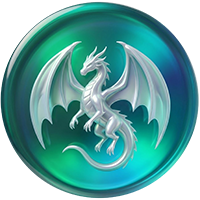

# 圆形玻璃图标

独立的圆形玻璃风格图标集合，可用于网页导航、个人主页和应用启动器。

覆盖清单包含 192 个不同名称；已完成 60 个，待完成 132 个。相同名称的重复导航共用图标。

## 使用方法

在下方找到图标，右键「原图地址」复制链接；编辑面板导航条目，选择「图片」，粘贴 URL 并保存。

地址使用 GitHub Raw 的公开 HTTPS 链接，不使用带令牌的私有链接。浏览器所在网络需要能访问该域名。

## 文件结构

- `originals/`：压缩包中 26 张原始 PNG，字节保持不变。
- `icons/`：导航条目对应的原图副本和新设计图标。
- `catalog.json`：名称、分组、远程地址、尺寸和校验值。
- `design/plan.json`：覆盖清单、设计提示词、来源和完成状态。

原图由仓库所有者提供。新增图标使用内置图像生成工具制作，部分私有工具采用功能主题图形；品牌相关图形为非官方风格化表现。

## 原始图标

| 预览 | 文件 | 原图地址 |
| --- | --- | --- |
|  | apple.png | [原图地址](https://raw.githubusercontent.com/ShowMak3r19/circular-glass-icons/main/originals/apple.png) |
|  | bahamute.png | [原图地址](https://raw.githubusercontent.com/ShowMak3r19/circular-glass-icons/main/originals/bahamute.png) |
|  | bilibili.png | [原图地址](https://raw.githubusercontent.com/ShowMak3r19/circular-glass-icons/main/originals/bilibili.png) |
|  | cesu.png | [原图地址](https://raw.githubusercontent.com/ShowMak3r19/circular-glass-icons/main/originals/cesu.png) |
|  | Crunchyroll.png | [原图地址](https://raw.githubusercontent.com/ShowMak3r19/circular-glass-icons/main/originals/Crunchyroll.png) |
|  | Crypto.png | [原图地址](https://raw.githubusercontent.com/ShowMak3r19/circular-glass-icons/main/originals/Crypto.png) |
|  | dishini.png | [原图地址](https://raw.githubusercontent.com/ShowMak3r19/circular-glass-icons/main/originals/dishini.png) |
|  | fcbk.png | [原图地址](https://raw.githubusercontent.com/ShowMak3r19/circular-glass-icons/main/originals/fcbk.png) |
|  | github.png | [原图地址](https://raw.githubusercontent.com/ShowMak3r19/circular-glass-icons/main/originals/github.png) |
|  | grok.png | [原图地址](https://raw.githubusercontent.com/ShowMak3r19/circular-glass-icons/main/originals/grok.png) |
|  | gugee.png | [原图地址](https://raw.githubusercontent.com/ShowMak3r19/circular-glass-icons/main/originals/gugee.png) |
|  | guonei.png | [原图地址](https://raw.githubusercontent.com/ShowMak3r19/circular-glass-icons/main/originals/guonei.png) |
|  | guowai.png | [原图地址](https://raw.githubusercontent.com/ShowMak3r19/circular-glass-icons/main/originals/guowai.png) |
|  | HBO.png | [原图地址](https://raw.githubusercontent.com/ShowMak3r19/circular-glass-icons/main/originals/HBO.png) |
|  | naifei.png | [原图地址](https://raw.githubusercontent.com/ShowMak3r19/circular-glass-icons/main/originals/naifei.png) |
|  | Open-AI.png | [原图地址](https://raw.githubusercontent.com/ShowMak3r19/circular-glass-icons/main/originals/Open-AI.png) |
|  | Reddit.png | [原图地址](https://raw.githubusercontent.com/ShowMak3r19/circular-glass-icons/main/originals/Reddit.png) |
|  | spy.png | [原图地址](https://raw.githubusercontent.com/ShowMak3r19/circular-glass-icons/main/originals/spy.png) |
|  | steam.png | [原图地址](https://raw.githubusercontent.com/ShowMak3r19/circular-glass-icons/main/originals/steam.png) |
|  | TG.png | [原图地址](https://raw.githubusercontent.com/ShowMak3r19/circular-glass-icons/main/originals/TG.png) |
|  | titok.png | [原图地址](https://raw.githubusercontent.com/ShowMak3r19/circular-glass-icons/main/originals/titok.png) |
|  | weiruan.png | [原图地址](https://raw.githubusercontent.com/ShowMak3r19/circular-glass-icons/main/originals/weiruan.png) |
|  | WhatsApp.png | [原图地址](https://raw.githubusercontent.com/ShowMak3r19/circular-glass-icons/main/originals/WhatsApp.png) |
|  | X.png | [原图地址](https://raw.githubusercontent.com/ShowMak3r19/circular-glass-icons/main/originals/X.png) |
|  | youtobe.png | [原图地址](https://raw.githubusercontent.com/ShowMak3r19/circular-glass-icons/main/originals/youtobe.png) |
|  | youxi.png | [原图地址](https://raw.githubusercontent.com/ShowMak3r19/circular-glass-icons/main/originals/youxi.png) |

## APP

| 预览 | 名称 | 原图地址 |
| --- | --- | --- |
|  | Emby | [原图地址](https://raw.githubusercontent.com/ShowMak3r19/circular-glass-icons/main/icons/001-emby.png) |
|  | MoviePilot | [原图地址](https://raw.githubusercontent.com/ShowMak3r19/circular-glass-icons/main/icons/002-moviepilot.png) |
|  | PVE | [原图地址](https://raw.githubusercontent.com/ShowMak3r19/circular-glass-icons/main/icons/003-pve.png) |
|  | iKuai | [原图地址](https://raw.githubusercontent.com/ShowMak3r19/circular-glass-icons/main/icons/004-ikuai.png) |
|  | MSM | [原图地址](https://raw.githubusercontent.com/ShowMak3r19/circular-glass-icons/main/icons/005-msm.png) |
|  | MatchRouter | [原图地址](https://raw.githubusercontent.com/ShowMak3r19/circular-glass-icons/main/icons/006-matchrouter.png) |
|  | 光猫 | [原图地址](https://raw.githubusercontent.com/ShowMak3r19/circular-glass-icons/main/icons/007-icon.png) |
|  | qb | [原图地址](https://raw.githubusercontent.com/ShowMak3r19/circular-glass-icons/main/icons/008-qb.png) |
|  | Transmission | [原图地址](https://raw.githubusercontent.com/ShowMak3r19/circular-glass-icons/main/icons/009-transmission.png) |
|  | 御坂 | [原图地址](https://raw.githubusercontent.com/ShowMak3r19/circular-glass-icons/main/icons/010-icon.png) |
|  | Momo | [原图地址](https://raw.githubusercontent.com/ShowMak3r19/circular-glass-icons/main/icons/011-momo.png) |
|  | BOBO | [原图地址](https://raw.githubusercontent.com/ShowMak3r19/circular-glass-icons/main/icons/012-bobo.png) |
|  | MDC-NG | [原图地址](https://raw.githubusercontent.com/ShowMak3r19/circular-glass-icons/main/icons/013-mdc-ng.png) |
|  | CMS | [原图地址](https://raw.githubusercontent.com/ShowMak3r19/circular-glass-icons/main/icons/014-cms.png) |
|  | EmbyToolkit | [原图地址](https://raw.githubusercontent.com/ShowMak3r19/circular-glass-icons/main/icons/015-embytoolkit.png) |
|  | EmbyPulse | [原图地址](https://raw.githubusercontent.com/ShowMak3r19/circular-glass-icons/main/icons/016-embypulse.png) |
|  | dockerCopilot | [原图地址](https://raw.githubusercontent.com/ShowMak3r19/circular-glass-icons/main/icons/017-dockercopilot.png) |
|  | Immortal | [原图地址](https://raw.githubusercontent.com/ShowMak3r19/circular-glass-icons/main/icons/018-immortal.png) |
|  | EmbyStats | [原图地址](https://raw.githubusercontent.com/ShowMak3r19/circular-glass-icons/main/icons/019-embystats.png) |
|  | MiniO | [原图地址](https://raw.githubusercontent.com/ShowMak3r19/circular-glass-icons/main/icons/020-minio.png) |
|  | Lucky | [原图地址](https://raw.githubusercontent.com/ShowMak3r19/circular-glass-icons/main/icons/021-lucky.png) |
|  | CloudDrive | [原图地址](https://raw.githubusercontent.com/ShowMak3r19/circular-glass-icons/main/icons/022-clouddrive.png) |
|  | MediaAutomator | [原图地址](https://raw.githubusercontent.com/ShowMak3r19/circular-glass-icons/main/icons/023-mediaautomator.png) |
|  | IT-Tool | [原图地址](https://raw.githubusercontent.com/ShowMak3r19/circular-glass-icons/main/icons/024-it-tool.png) |
|  | AngeBoard | [原图地址](https://raw.githubusercontent.com/ShowMak3r19/circular-glass-icons/main/icons/025-angeboard.png) |
|  | 9KG | [原图地址](https://raw.githubusercontent.com/ShowMak3r19/circular-glass-icons/main/icons/026-9kg.png) |
|  | MSM授权 | [原图地址](https://raw.githubusercontent.com/ShowMak3r19/circular-glass-icons/main/icons/027-msm.png) |
|  | HDSky-Dice | [原图地址](https://raw.githubusercontent.com/ShowMak3r19/circular-glass-icons/main/icons/028-hdsky-dice.png) |
|  | Forward Widget Hub | [原图地址](https://raw.githubusercontent.com/ShowMak3r19/circular-glass-icons/main/icons/029-forward-widget-hub.png) |
|  | TelegramBot 控制台 | [原图地址](https://raw.githubusercontent.com/ShowMak3r19/circular-glass-icons/main/icons/030-telegrambot.png) |
|  | TelegramAIBot 管理台 | [原图地址](https://raw.githubusercontent.com/ShowMak3r19/circular-glass-icons/main/icons/031-telegramaibot.png) |
|  | 聚影 | [原图地址](https://raw.githubusercontent.com/ShowMak3r19/circular-glass-icons/main/icons/032-icon.png) |
|  | HDSky 社区通行证 | [原图地址](https://raw.githubusercontent.com/ShowMak3r19/circular-glass-icons/main/icons/033-hdsky.png) |
|  | NONO | [原图地址](https://raw.githubusercontent.com/ShowMak3r19/circular-glass-icons/main/icons/034-nono.png) |
|  | Muvyo | [原图地址](https://raw.githubusercontent.com/ShowMak3r19/circular-glass-icons/main/icons/035-muvyo.png) |
|  | MR授权管理 | [原图地址](https://raw.githubusercontent.com/ShowMak3r19/circular-glass-icons/main/icons/036-mr.png) |

## AI

| 预览 | 名称 | 原图地址 |
| --- | --- | --- |
|  | Sub2API | [原图地址](https://raw.githubusercontent.com/ShowMak3r19/circular-glass-icons/main/icons/037-sub2api.png) |
|  | CPA | [原图地址](https://raw.githubusercontent.com/ShowMak3r19/circular-glass-icons/main/icons/038-cpa.png) |
|  | CPA用量 | [原图地址](https://raw.githubusercontent.com/ShowMak3r19/circular-glass-icons/main/icons/039-cpa.png) |
|  | CPA2 | [原图地址](https://raw.githubusercontent.com/ShowMak3r19/circular-glass-icons/main/icons/040-cpa2.png) |
|  | CPA用量2 | [原图地址](https://raw.githubusercontent.com/ShowMak3r19/circular-glass-icons/main/icons/041-cpa-2.png) |
|  | ChatGPT2API | [原图地址](https://raw.githubusercontent.com/ShowMak3r19/circular-glass-icons/main/icons/042-chatgpt2api.png) |
|  | GPT自动登录 | [原图地址](https://raw.githubusercontent.com/ShowMak3r19/circular-glass-icons/main/icons/043-gpt.png) |
|  | GPT账号管理助手 | [原图地址](https://raw.githubusercontent.com/ShowMak3r19/circular-glass-icons/main/icons/044-gpt.png) |
|  | AIClient2API | [原图地址](https://raw.githubusercontent.com/ShowMak3r19/circular-glass-icons/main/icons/045-aiclient2api.png) |
|  | Open WebUI | [原图地址](https://raw.githubusercontent.com/ShowMak3r19/circular-glass-icons/main/icons/046-open-webui.png) |
|  | 卡网 | [原图地址](https://raw.githubusercontent.com/ShowMak3r19/circular-glass-icons/main/icons/047-icon.png) |

## PT

| 预览 | 名称 | 原图地址 |
| --- | --- | --- |

## 人工智能

| 预览 | 名称 | 原图地址 |
| --- | --- | --- |
|  | ChatGPT | [原图地址](https://raw.githubusercontent.com/ShowMak3r19/circular-glass-icons/main/icons/063-chatgpt.png) |
|  | Grok | [原图地址](https://raw.githubusercontent.com/ShowMak3r19/circular-glass-icons/main/icons/075-grok.png) |

## 视频资讯

| 预览 | 名称 | 原图地址 |
| --- | --- | --- |
|  | Google | [原图地址](https://raw.githubusercontent.com/ShowMak3r19/circular-glass-icons/main/icons/085-google.png) |
|  | Reddit | [原图地址](https://raw.githubusercontent.com/ShowMak3r19/circular-glass-icons/main/icons/087-reddit.png) |
|  | Youtube | [原图地址](https://raw.githubusercontent.com/ShowMak3r19/circular-glass-icons/main/icons/089-youtube.png) |
|  | Netflix | [原图地址](https://raw.githubusercontent.com/ShowMak3r19/circular-glass-icons/main/icons/090-netflix.png) |
|  | Disney+ | [原图地址](https://raw.githubusercontent.com/ShowMak3r19/circular-glass-icons/main/icons/091-disney.png) |
|  | HBO Max | [原图地址](https://raw.githubusercontent.com/ShowMak3r19/circular-glass-icons/main/icons/092-hbo-max.png) |
|  | TikTok | [原图地址](https://raw.githubusercontent.com/ShowMak3r19/circular-glass-icons/main/icons/093-tiktok.png) |
|  | Spotify | [原图地址](https://raw.githubusercontent.com/ShowMak3r19/circular-glass-icons/main/icons/094-spotify.png) |
|  | 抖音 | [原图地址](https://raw.githubusercontent.com/ShowMak3r19/circular-glass-icons/main/icons/102-icon.png) |
|  | Bilibili | [原图地址](https://raw.githubusercontent.com/ShowMak3r19/circular-glass-icons/main/icons/104-bilibili.png) |

## 服务应用

| 预览 | 名称 | 原图地址 |
| --- | --- | --- |
|  | Github | [原图地址](https://raw.githubusercontent.com/ShowMak3r19/circular-glass-icons/main/icons/110-github.png) |

## 资源下载

| 预览 | 名称 | 原图地址 |
| --- | --- | --- |

## 金融经济

| 预览 | 名称 | 原图地址 |
| --- | --- | --- |

## 网络工具

| 预览 | 名称 | 原图地址 |
| --- | --- | --- |

## 其他工具

| 预览 | 名称 | 原图地址 |
| --- | --- | --- |

## Momo

| 预览 | 名称 | 原图地址 |
| --- | --- | --- |
